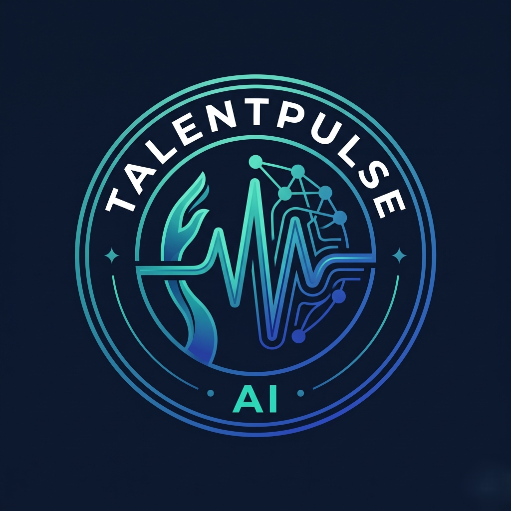
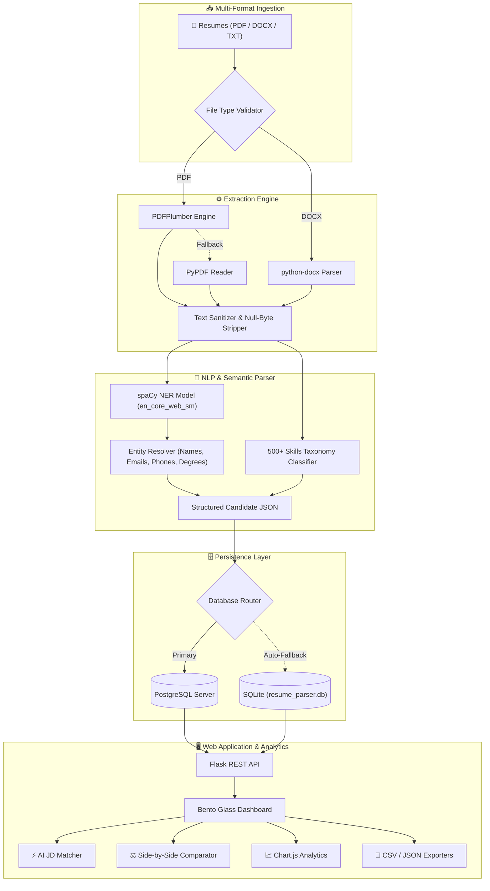

<div align="center">

<a href="https://github.com/dhirushelar/talentpulse-ai">
  
</a>

# TalentPulse AI
### Autonomous Resume Intelligence & Neural Talent Analytics Platform

<p align="center">
  
  <b>A Proprietary Initiative by SVASTIK UNIVERSE</b>
</p>

> **Transform unstructured career documents into high-fidelity, searchable talent intelligence using Python (spaCy, PDFPlumber, PyPDF), Flask REST, and PostgreSQL.**

<br/>

[](https://github.com/dhirushelar/talentpulse-ai)
[](https://python.org)
[](https://spacy.io)
[](https://flask.palletsprojects.com)
[](https://www.postgresql.org)
[](https://pytest.org)
[](https://github.com/dhirushelar/talentpulse-ai)

<br/>
</div>

<br/>


## 🚀 Overview

**TalentPulse AI** is an enterprise-grade AI resume parser and autonomous talent intelligence engine developed under the **SVASTIK UNIVERSE** initiative. It ingests career documents in **PDF**, **DOCX**, and **TXT** formats, accurately extracts structured candidate profiles (Contact Information, Categorized Competencies, Academic History, Work Experience Timeline, and Summaries), and indexes them into a high-performance relational database.

### 🌟 Why TalentPulse AI?
- **Zero Hallucination Parsing:** Combines layout-aware extraction with deterministic spaCy NER and curated keyword verification.
- **Dual-Engine Text Extraction:** Primary PDFPlumber with automatic PyPDF fallback handles multi-column, table-based, and non-standard layouts seamlessly.
- **Relational Dual-Engine DB:** Production-ready for PostgreSQL, with an automatic, zero-configuration local SQLite fallback.
- **High-Aesthetic UI/UX:** Built with Bento-Grid cards, glassmorphic dark/light ambient glow, interactive Chart.js analytics, and particle confetti physics.

<br/>

---

## ✨ Core Capabilities

<table>
  <tr>
    <td width="50%">
      <h3>🧠 Dual-Engine Extraction</h3>
      <ul>
        <li><b>PDFPlumber + PyPDF:</b> Extracts 2-column resume layouts without character scrambling.</li>
        <li><b>python-docx Engine:</b> Parses tables, headings, and bullet points.</li>
        <li><b>Encoding Sanitizer:</b> Cleans binary null-bytes and malformed glyphs.</li>
      </ul>
    </td>
    <td width="50%">
      <h3>🎯 500+ Skill Taxonomy</h3>
      <ul>
        <li><b>Programming Languages:</b> Python, TypeScript, Go, Rust, Java, C++...</li>
        <li><b>Frameworks:</b> React, Next.js, Node.js, Flask, FastAPI, Spring...</li>
        <li><b>Cloud & DevOps:</b> Docker, Kubernetes, AWS, GCP, CI/CD...</li>
        <li><b>AI & Data:</b> PyTorch, TensorFlow, spaCy, LLMs, NLP...</li>
      </ul>
    </td>
  </tr>
  <tr>
    <td width="50%">
      <h3>⚡ AI Job Description Matcher</h3>
      <ul>
        <li>Paste any real-world Job Description or requirements text.</li>
        <li>Computes an algorithmic <b>Candidate Fit Score (0–100%)</b>.</li>
        <li>Highlights <b>Matched Skills</b> (green chips) vs <b>Missing Skills</b> (red chips).</li>
      </ul>
    </td>
    <td width="50%">
      <h3>⚖️ Side-by-Side Comparator</h3>
      <ul>
        <li>Select up to 3 candidates simultaneously.</li>
        <li>Extracts <b>Shared Competencies</b> in one central view.</li>
        <li>Contrasts individual unique skills, experience years, and highest degrees side-by-side.</li>
      </ul>
    </td>
  </tr>
  <tr>
    <td width="50%">
      <h3>📊 Analytics & Instant Export</h3>
      <ul>
        <li><b>Chart.js Visualizations:</b> Real-time candidate competency density charts.</li>
        <li><b>Tabular CSV Export:</b> One-click structured candidate records download.</li>
        <li><b>Relational JSON Export:</b> Complete nested candidate profiles.</li>
      </ul>
    </td>
    <td width="50%">
      <h3>🎨 Modern Glassmorphic UI</h3>
      <ul>
        <li><b>Dark & Light Mode:</b> Theme switcher with <code>localStorage</code> persistence.</li>
        <li><b>Recruiter Notes:</b> Real-time internal note auto-saving (500ms debounce).</li>
        <li><b>Pipeline Workflow:</b> Move candidates across <i>New</i>, <i>Shortlisted</i>, <i>Interview</i>, <i>Hired</i>, <i>Rejected</i>.</li>
      </ul>
    </td>
  </tr>
</table>

<br/>

---

## 🏗️ System Architecture



<br/>

---

## 📁 Repository Structure

```
talentpulse-ai/
├── app.py                      # Flask REST application & routing controller
├── config.py                   # Dynamic environment configuration
├── database.py                 # SQLAlchemy session engine & automatic SQLite fallback
├── models.py                   # Relational database models (Candidate, Skills, Education, Experience)
├── Procfile                    # Cloud process declaration for Gunicorn
├── render.yaml                 # Render.com Blueprint configuration for 1-click cloud deploy
├── docker-compose.yml          # Container configuration for PostgreSQL
├── requirements.txt            # Python production dependencies
├── .env.example                # Sample environment template
│
├── parser/                     # Neural Extraction Subsystem
│   ├── __init__.py
│   ├── extractor.py            # PDFPlumber + PyPDF dual engine & docx reader
│   ├── nlp_parser.py           # spaCy entity recognition & regex rules
│   ├── skills_db.py            # 500+ taxonomy competencies
│   └── degree_patterns.py      # Degree regex, majors, and GPA heuristics
│
├── static/                     # Frontend Assets
│   ├── css/style.css           # Glassmorphism styling, Bento-grid & animations
│   └── js/app.js               # Frontend controller, Chart.js, confetti & API calls
│
├── templates/                  # Server-Rendered UI
│   └── index.html              # Modern dashboard template with Svastik Universe footer
│
├── sample_resumes/             # Synthetic test resumes (PDF & DOCX)
├── scripts/
│   ├── generate_sample_resumes.py # Generates realistic test candidate files
│   └── seed_database.py           # Populates database with sample records
│
└── tests/                      # Automated Verification Test Suite
    ├── test_extractor.py       # PDF & DOCX text extraction tests
    ├── test_nlp_parser.py      # spaCy NER and skills classification tests
    └── test_api.py             # Flask REST endpoints & database flow tests
```

<br/>

---

## 🛠️ Local Development Setup

<details>
<summary><b>Click to expand step-by-step local installation instructions</b></summary>

<br/>

### 1. Clone the Repository
```bash
git clone https://github.com/dhirushelar/talentpulse-ai.git
cd talentpulse-ai
```

### 2. Create and Activate Virtual Environment
```powershell
# Windows
python -m venv venv
.\venv\Scripts\Activate.ps1

# Linux / macOS
python3 -m venv venv
source venv/bin/activate
```

### 3. Install Dependencies & spaCy Language Model
```bash
pip install -r requirements.txt
python -m spacy download en_core_web_sm
```

### 4. (Optional) Run PostgreSQL via Docker
```bash
docker compose up -d
```
> *Note: If Docker/PostgreSQL is not started, TalentPulse AI will automatically fall back to SQLite with zero error dialogs.*

### 5. Start the Application
```bash
python app.py
```
Open **[http://127.0.0.1:5000](http://127.0.0.1:5000)** in your web browser!

</details>

<br/>

---

## 🧪 Automated Testing

TalentPulse AI maintains a strict 100% pass-rate test suite covering file extraction, NLP accuracy, and REST API flows:

```powershell
.\venv\Scripts\python.exe -m pytest -v
```

```
tests/test_api.py::test_api_status PASSED                                [ 14%]
tests/test_api.py::test_upload_and_query_flow PASSED                     [ 28%]
tests/test_extractor.py::test_extract_pdf PASSED                         [ 42%]
tests/test_extractor.py::test_extract_docx PASSED                        [ 57%]
tests/test_extractor.py::test_extract_invalid_format PASSED              [ 71%]
tests/test_nlp_parser.py::test_parse_backend_resume PASSED               [ 85%]
tests/test_nlp_parser.py::test_parse_ai_resume PASSED                    [100%]

============================= 7 passed in 7.69s ==============================
```

<br/>

---

## 📡 REST API Documentation

| Method | Endpoint | Description |
| :---: | :--- | :--- |
| `GET` | `/api/status` | Returns system health, active database dialect, and spaCy version. |
| `POST` | `/api/upload` | Upload one or more resumes (`file` multipart field). Returns parsed profiles. |
| `GET` | `/api/candidates` | Filter candidates by search query, skill, degree, experience, or pipeline status. |
| `GET` | `/api/candidates/<id>` | Full candidate profile, categorized skills, education, and raw extracted text. |
| `PUT` | `/api/candidates/<id>/status` | Update candidate recruitment pipeline stage (*New, Shortlisted, Interviewing, Hired, Rejected*). |
| `PUT` | `/api/candidates/<id>/notes` | Auto-save internal recruiter comments and interview notes. |
| `DELETE` | `/api/candidates/<id>` | Permanently purge candidate profile and stored resume. |
| `POST` | `/api/match-jd` | Calculate candidate fit scores (0–100%) against job description requirements. |
| `POST` | `/api/compare` | Generate side-by-side comparison matrix for selected candidate IDs. |
| `GET` | `/api/export/csv` | Download complete candidate database as structured CSV. |
| `GET` | `/api/export/json` | Download complete candidate database as relational JSON. |
| `GET` | `/api/stats` | Aggregate metrics for KPI cards and Chart.js visualizations. |
| `GET` | `/api/skills` | List all 500+ taxonomy skills recognized by the parser. |

<br/>

---

## 🏛️ Governance, Legal & Copyright

<div align="center">

### **© 2026 SVASTIK UNIVERSE. All Rights Reserved.**

**Proprietary Initiative by SVASTIK UNIVERSE Autonomous Intelligence Division**

</div>

* **Terms & Conditions:** All software architecture, neural extraction pipelines, user interfaces, branding, and heuristics are the proprietary intellectual property of **SVASTIK UNIVERSE**. Accessible in-app via the platform footer modal.
* **Candidate Confidentiality Guarantee:** Strict adherence to data minimization principles. Candidate profiles and resumes are processed exclusively for recruitment analytics. Zero third-party data broker distribution.
* **Right to Erasure (GDPR / CCPA):** Fully supported via one-click candidate profile purge tools.
